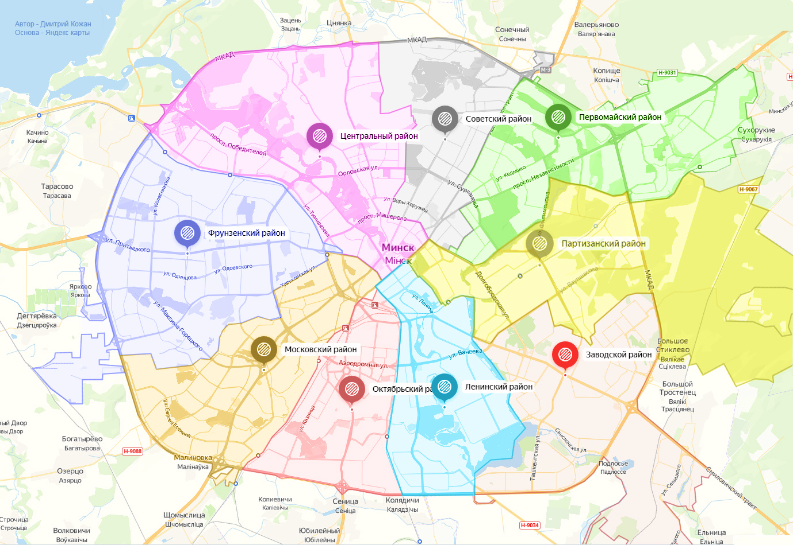

English | [Русский](README.ru.md)

# Minsk Rental Market Analysis

Analysis of long-term apartment rental listings in Minsk, focusing on pricing, location effects, and recorded price adjustments across different market segments.

Median values are used throughout the analysis because the asking-rent distribution is right-skewed. A small number of high-priced listings would disproportionately affect the mean.

## Minsk Districts



*Map: Dmitry Kozhan via [Wikimedia Commons](https://commons.wikimedia.org/wiki/File:%D0%9A%D0%B0%D1%80%D1%82%D0%B0_%D1%80%D0%B0%D0%B9%D0%BE%D0%BD%D0%BE%D0%B2_%D0%9C%D0%B8%D0%BD%D1%81%D0%BA%D0%B0.jpg), [CC BY-SA 4.0](https://creativecommons.org/licenses/by-sa/4.0/).*

## Key Findings

* The median asking rent in the **October 28, 2026** snapshot is **\$700 per month**, with a median rent of approximately **\$13.1/m²**. Median monthly rent by room count is shown below.

  | Number of rooms | Median monthly rent, USD |
  | --- | ---: |
  | 1 | 550 |
  | 2 | 700 |
  | 3 | 900 |

---

* **Central district** has the highest median monthly asking rent at **\$934**, while **Oktyabrsky district** has the highest median rent per square meter at approximately **\$15.5/m²**.

  | District | Listings | Median monthly rent, USD | Median rent per m², USD |
  | --- | ---: | ---: | ---: |
  | Central | 332 | 934 | 14.3 |
  | Pervomaisky | 229 | 713 | 13.3 |
  | Sovetsky | 166 | 708 | 11.9 |
  | Oktyabrsky | 265 | 668 | 15.5 |
  | Moskovsky | 205 | 657 | 12.6 |
  | Partizansky | 60 | 656 | 12.1 |
  | Leninsky | 88 | 647.5 | 11.2 |
  | Frunzensky | 217 | 600 | 11.0 |
  | Zavodskoy | 40 | 504.5 | 10.7 |

  Total monthly rent also reflects apartment size, so differences in listing composition can affect district rankings. Rent per square meter provides a complementary comparison across districts.

---

* Listings within **5 km of October Square** have a higher median rent per square meter than listings farther away, with a difference of approximately **18.7%**.

  | Distance to October Square | Listings | Median rent per m², USD |
  | --- | ---: | ---: |
  | Within 5 km | 955 | 14.13 |
  | Beyond 5 km | 669 | 11.90 |

  Distance is measured in a straight line from the Zero Kilometer monument on October Square. Differences in apartment size and listing composition may also influence the comparison.

---

* Agency listings have a higher median monthly asking rent than private listings, but they also represent larger apartments. The difference in median rent per square meter is smaller, at approximately **5%**.

  | Seller type | Listings | Median monthly rent, USD | Median area, m² | Median rent per m², USD |
  | --- | ---: | ---: | ---: | ---: |
  | Agency | 376 | 800 | 63.35 | 13.55 |
  | Private | 1,248 | 679 | 52.00 | 12.90 |

  These comparisons do not isolate the effect of seller type from differences in apartment size, location, and other listing characteristics.

---

* Recorded price history is available for **1,585 of the 1,624 listings** in the October snapshot. Of these, **832 (52.5%)** contain at least one recorded price change. Among listings with price changes, **61.3%** were repriced multiple times, with a median of **two changes per listing**.

---

* The **higher price segment** has the highest share of listings with recorded price changes. Recorded decreases are more common than increases in all three segments, while the **middle segment** has the largest gap between the shares with decreases and increases.

  | Price segment | Current monthly rent, USD | Any recorded change | Recorded increase | Recorded decrease |
  | --- | ---: | ---: | ---: | ---: |
  | Lower | rent ≤ 600 | 45.3% | 29.2% | 35.4% |
  | Middle | 600 < rent ≤ 832 | 53.5% | 31.6% | 44.1% |
  | Higher | rent > 832 | 59.1% | 39.0% | 47.0% |

  Segments are based on tertiles of current monthly asking rent. Percentages refer to listings with available price history. A listing may contain both increases and decreases.

---

## Analysis

The project includes:

* data quality checks and categorical normalization;
* rental price analysis by room count and district;
* comparison of monthly rent and rent per square meter;
* location analysis using distance from the Zero Kilometer monument on October Square;
* comparison of apartment and seller characteristics;
* analysis of recorded price increases and decreases;
* combined district and room-count analysis;
* practical interpretation and market-oriented recommendations.

A sensitivity check compares unfiltered asking rents with IQR and room-count-based log-MAD filters. Median monthly rent remains between **\$679** and **\$700**, while the mean is more sensitive to extreme prices. Statistically flagged listings are retained in the main analysis because unusual prices cannot be confidently identified as data errors without additional listing context.

The full analysis is available in the notebook:

[`minsk_rental_market_analysis.ipynb`](minsk_rental_market_analysis.ipynb)

## Data Collection

The main analysis uses a snapshot collected from **Realt.by** on **October 28, 2026** using a custom Python collector included in this repository.

The October snapshot contains:

* **1,624 rental listings**
* **4,665 recorded price history entries**

The exported CSV files contain structured listing and price-history data and exclude contact details, photographs, listing descriptions, and full street addresses.

The October snapshot is included in the `data/` directory. The initial snapshot collected on **September 5, 2026** is also retained for comparison in the notebook. Both snapshots allow the analysis to be reproduced without collecting the data again.

## Tech Stack

* Python
* pandas
* NumPy
* matplotlib
* requests
* JupyterLab

## Run Locally

Clone the repository:

```bash
git clone https://github.com/nikolaitolmachev/minsk-rental-market-analysis.git
cd minsk-rental-market-analysis
```

Create and activate a virtual environment:

```bash
python3 -m venv .venv
source .venv/bin/activate
```

Install dependencies:

```bash
python -m pip install --upgrade pip
python -m pip install -r requirements.txt
```

Start JupyterLab:

```bash
jupyter lab
```

## Collector

Run a small collection as a smoke test:

```bash
python collect_realt.py --max-ads 10
```

Run the full collector:

```bash
python collect_realt.py
```

The included CSV snapshots allow the analysis to be reproduced without collecting the data again.
